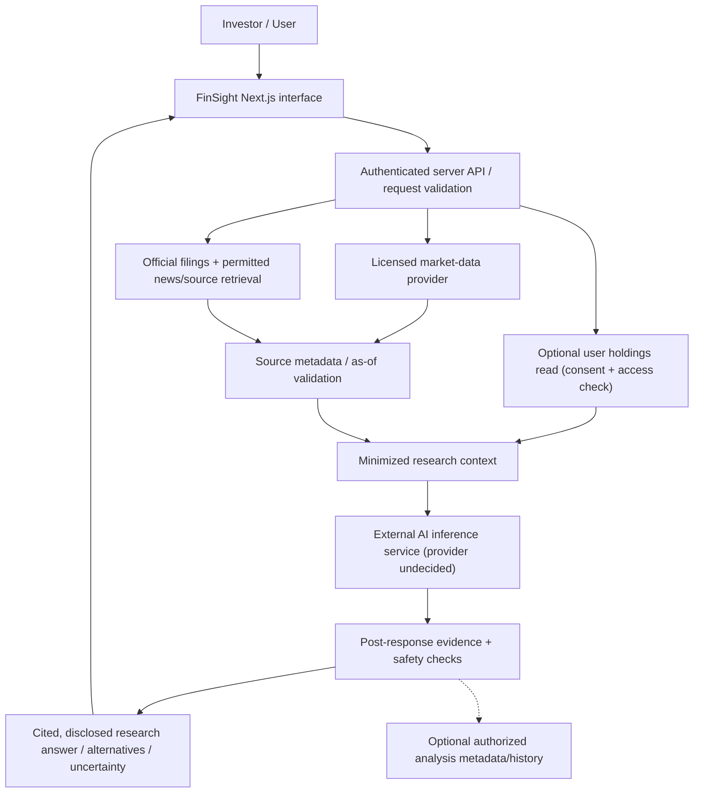

# FinSight AI — conversational research vision and safe engineering plan

**Status: user-proposed product expansion (November 2026), not an approved Sprint 4–6 requirement or a functioning AI service.** The existing requirement **FR-04 / US-03** calls only for understandable AI-generated stock/market explanations with disclosure and historical risk information. The existing frontend uses **template text** (not an AI model). This file records the broader vision without silently promoting it to MVP.

## 1. Proposed experience

Users could ask a conversational **FinSight AI** to help research a public company, exchange-traded security or investment theme. The assistant would:
1. Clarify the company/ticker, research question and data as-of date.
2. Retrieve permitted **market data**, **official filings/company releases**, and appropriately licensed reporting.
3. Extract notable claims, source links, publication/event dates, and conflicts across sources.
4. Cross-check major claims against original documents and independent corroboration; mark **Confirmed / Contested / Unverified / Outdated / Insufficient data** with explanations.
5. Identify **documented** business relationships such as subsidiaries, suppliers, customers or collaborations, with sourced effective dates; don't invent associations just because companies operate in the same industry.
6. Explain relevant performance history, uncertainty, data gaps, possible scenarios, tradeoffs and questions worth investigating.
7. Optionally, **only with user consent and an approved scope**, use self-entered holdings to explain concentration, overlap, diversification characteristics and exposure. This is **informational portfolio research**, not automatic individualized instructions to buy or sell securities.
8. Save a citation-backed research report or conversation **only under authorized access and defined retention rules**, if the feature is approved.

**Example question (not an implemented capability):** “What has changed at Company X this week, which publicly disclosed partners could be affected, and how would that exposure overlap with holdings I entered?” A useful answer would list *sources, publication dates, evidence limitations, why each relationship matters and several risk scenarios*.

## 2. Source verification is not AI-text detection

An “AI-generated content detector” cannot reliably determine whether a news claim is true. **Text-style detection ≠ factual verification.** FinSight should prioritize:
- **Source provenance:** original URL, publisher, author where known, filing accession or official announcement ID, published date, retrieved date and licensing/usage restrictions.
- **Evidence:** exact claim, relevant excerpt (only if licensing permits), confirming or conflicting source IDs and the event date.
- **Time:** distinguish when an article was written, when an event occurred and when a quote was priced; display missing or delayed context.
- **Confidence description:** transparent *what was checked* and *what remains uncertain*. Do not invent a numeric “98% verified” score.
- **Manipulation/risk checks:** distinguish opinions, promotional content, unverified rumors, satire and clearly falsified attributions.
- **Update/retraction handling:** stale source flags; invalidate summaries when facts or confirmations change.

A model can still hallucinate citations and facts. **Validate URLs and retrieved source IDs server-side before showing the answer.** A model-only claim without a verifiable source should be labeled unverified, not presented as fact.

## 3. Proposed architecture (not deployed)

**The database does not itself fetch news or run a model.** Select providers separately, check costs, license/retention terms, quotas, and server-side key handling. External portfolio data access should require a deliberate user-facing choice.

## 4. Source vs proposal traceability

| Capability | Support in supplied records | Status |
| --- | --- | --- |
| Understand stock movement with AI-generated explanation | FR-04, US-03; Sprint 5 process 5.0; Sprint 6 UC-02 | **Approved baseline / not implemented with a real model** |
| Display historical risk and appropriate uncertainty | FR-08, NFR-07; Sprint 5 5.4 Review AI Response; Sprint 6 AI disclosure | **Approved baseline** |
| Gather/filter news across sources, identify trends/alerts | Sprint 1–2 original vision and investigation | **Historic candidate, not part of FR-01–FR-08** |
| Portfolio/holdings and gain/loss tracking | Sprint 3 management plan; generic Fintech data examples | **Separate candidate requiring scope decision** |
| Conversational multi-turn chat, research provenance and verified relationships | More recent product discussion | **New proposal; no source-provided detailed use cases** |
| Holdings-aware research scenarios | More recent product discussion | **New proposal; privacy/consent review required** |
| Personalized specific company buy/sell instructions and “where to invest” | **Conflicts** with combined Sprint 4–5 excluded personalized advice and Sprint 6 non-advice | **Out of current scope; requires formal review, likely legal/compliance guidance** |
| Brokerage or bank linking / executing real trades | Explicitly excluded in combined Sprint 4–5 and backend presentation | **Out of scope** |

## 5. Proposed AI data structures (if separately approved)

- `research_sources`: source ID, canonical URL, publisher, source type, title, published/event/retrieved date, permission and checksum/reference.
- `claims` and `claim_evidence`: scoped claim, related stock/company ID, source IDs, confirmation/dispute status, assessment method and reviewer timestamps.
- `company_relationships`: source company, target, relationship (subsidiary/partner/supplier/customer), temporal validity, direct source IDs, review status.
- `ai_conversations` / `ai_messages`: user ownership, role, minimal text, cited source IDs, creation/retention; default minimize personal data.
- `research_reports`: report ID, as-of date, reviewed evidence references, uncertainty, generic scenarios, disclosure and refresh expiry.
- `holdings`: optional user-entered shares/cost and last update; **private and never stored in shared market-data caches**.
- Existing `analysis_runs` / D4 records for FR-04 can store only request/result **metadata** without raw sensitive prompts, consistent with Sprint 5.

These are **not tables already deployed** and differ from the generic bank-account data tree. See [database design plan](DATABASE_DESIGN_PLAN.md).

## 6. Acceptance gates for a safe research MVP

- [ ] Verify current FR-04 explanation from a selected symbol using real timestamped, licensed data and a real AI service.
- [ ] Ensure citations resolve to retrieved actual sources; distinguish source date from quote time.
- [ ] Handle unsupported claims, conflicting sources, unavailable provider, stale quotes, and model outages without fabricated facts.
- [ ] Display AI-generated disclosure, uncertainty, historical/past performance, non-advice status.
- [ ] Evaluate rate limits and privacy retention; no API secrets in browser.
- [ ] For later **chat**, test authorized history deletion, multi-turn context, prompt injection from hostile articles, source manipulation and user-specific data isolation.
- [ ] For later **holdings**, require explicit consent, user-owned access, privacy deletion, and legally reviewed claims about suitability/personalized recommendations.
- [ ] Obtain team/instructor approval for expanded US IDs and acceptance tests before calling it a release commitment.

## 7. Team responsibility proposals (not assignments)

Salih coordinates **scope/acceptance/compliance questions**; Jake may design chat/report UI; Asad may design **private data/API/storage**; Henry may research **AI orchestration, citations and evaluation**. These are charter-aligned suggestions; do not assign GitHub accounts without their agreement.

[Core FR-04 Issue #39](https://github.com/JustEmre12/FinSight/issues/39) · [AI service decision #27](https://github.com/JustEmre12/FinSight/issues/27) · [Source and scope decision #25](https://github.com/JustEmre12/FinSight/issues/25) · [Versioned scope](SCOPE_AND_EVOLUTION.md).
